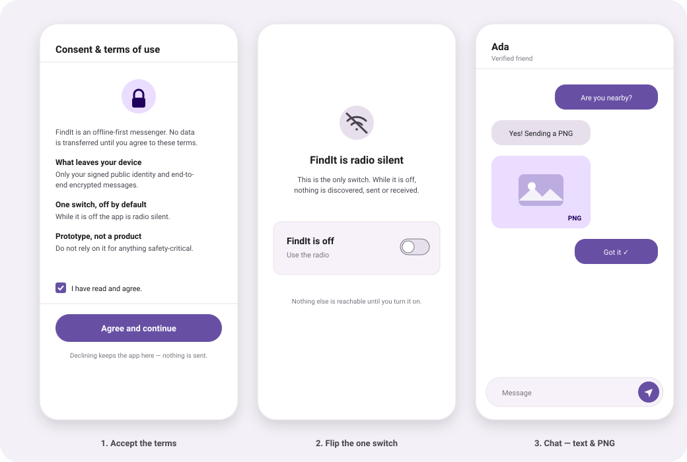
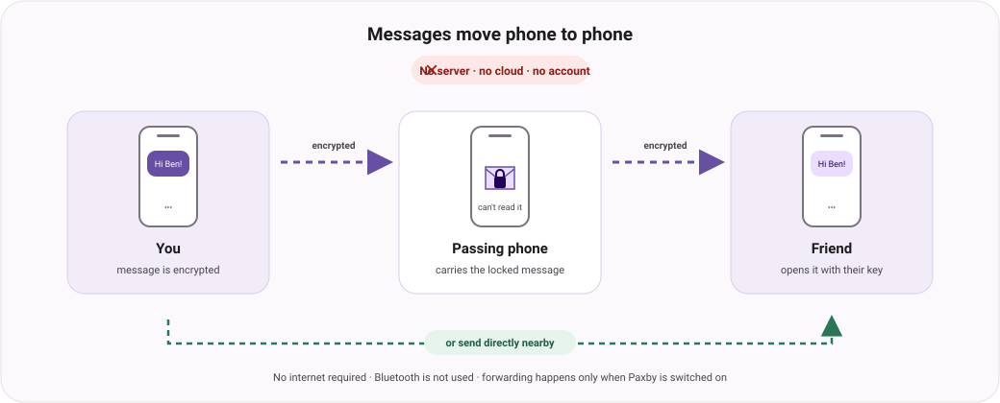

# FindIt

**Offline-first messaging that needs no account, no server and no internet.**

FindIt is an Android messenger for phones that are physically near each other.
Text messages and PNG images hop directly between devices over Wi-Fi Direct, and
can be carried onward by other phones you pass by (*store-carry-forward*) — with
no cloud in the middle.

[](https://github.com/Souhar-dya/findit-offline-messenger/actions/workflows/ci.yml)
[](https://github.com/Souhar-dya/findit-offline-messenger/releases/latest)



---

## Status: 1.0.0 — working on Android

- **Real, running app.** Version 1.0.0 ships as signed APKs you can install on
  Android 7.0 and newer.
- **Verified on real phones.** Two-way text and PNG delivery was run on a
  Samsung SM-G990E and a Motorola Edge 60 Pro: they discover each other, form a
  direct link, complete a verified handshake, and show delivery receipts.
- **No lies about reach.** FindIt says exactly what it can do. There are no fake
  "nearby" devices, no Bluetooth fallback, and it never pretends to be online
  when it isn't.
- **Honest limits** are listed in [*What's verified and what isn't*](#whats-verified-and-what-isnt).
  The short version: the **Android** app is done and tested; the **iOS** app is
  not built yet, and a few optional radio extras are future work.

---

## What FindIt does

- **Message with no network.** No account, no phone number, no SIM, no internet.
  Your identity is a key pair created on the device.
- **Text and PNG images.** Send text and lossless PNG pictures. Every message is
  end-to-end encrypted and signed.
- **Mutual contacts only.** Add someone by scanning their identity QR (public
  information only). A chat opens only after **both** sides accept.
- **Store-carry-forward.** If your friend isn't nearby, your phone can hand the
  encrypted message to another phone passing by, which carries it onward.
  Carriers can **never** read it.
- **Notifications for real arrivals.** When a message is decrypted for you, you
  get a normal Android notification. Because only your phone holds your private
  key, a notification can never be shown for somebody else's message.
- **One switch, off by default.** Until you turn it on, FindIt is completely
  **radio silent**. That single switch controls *everything* — discovery,
  sending, receiving and relaying.

---

## Download & install (Android)

Open the **[latest release](../../releases/latest)** and download the file that
matches your phone:

| Your device | File to download |
| --- | --- |
| Almost any phone from ~2016 onwards | **`findit-<version>-arm64-v8a.apk`** ← recommended |
| Older 32-bit phone, or you're not sure | `findit-<version>-universal.apk` (works everywhere, larger) |
| Android emulator / some Chromebooks | `findit-<version>-x86_64.apk` |

**Install:**

1. On your phone, open the release page and download the APK above.
2. Android will ask to allow installs from this source — allow it
   (**Settings → Apps → Special app access → Install unknown apps** → your
   browser or files app).
3. Open the downloaded `.apk` and install.
4. Launch **FindIt**.

The APKs are built from source by GitHub Actions on every release and signed
with the project's own release key. If you installed an **early `v0.1.0` build**,
uninstall it first — that one was debug-signed.

**iPhone/iPad:** there is no download yet. The iOS build isn't finished and would
need an Apple Developer account plus App Store / TestFlight review.

---

## Using FindIt

**1 · Accept the terms.** On first launch you read a short terms page and tick
*"I have read and agree."* Nothing is sent or received before this.

**2 · Flip the one switch.** Next you see a single switch — and *nothing else*.
It is **off**, which means FindIt is radio silent: nothing is being discovered,
and nothing is sent or received, not even your own messages. Turn it on and the
rest of the app appears. Turn it off again any time (Profile) and it goes quiet
immediately, dropping any messages it was carrying for other people.

**3 · Create your identity.** Choose a display name. Your keys are generated on
the device; the private half is stored in the platform secure storage (Android
Keystore) and is **never exported**.

**3 · Add a contact.** In the **Friends** tab, tap **Add friend** and either scan
the other person's identity QR (Friends / Profile) or paste their identity
payload. Then send a friend request — the chat opens only when they accept.

**4 · Send messages.** Open a contact and send text, or attach a PNG image. A
signed delivery receipt flips the message to *delivered* once it actually
arrives.

**Nearby** shows what the transport can really do and which peers it has
genuinely discovered — it never invents devices to look busy.

---

## How it works



FindIt is deliberately small and readable. Every claim below is implemented in
the open source in this repository.

- **Your identity is local.** A signing key (Ed25519) and a key-agreement key
  (X25519) are generated on the device. Your `fid_…` id is derived from the
  public key, and the private half lives only in the OS secure storage.
- **Messages are end-to-end encrypted.** Each message is encrypted to the
  recipient (X25519 → HKDF → AES-256-GCM) and separately signed (Ed25519), so
  the phones carrying it can check it is authentic without being able to read it.
- **Contacts are mutual and out-of-band.** Your QR contains only *public*
  identity information, and you exchange it face to face. Nothing is ever added
  silently, and a chat opens only when both sides accept.
- **Routing is store-carry-forward.** Messages have no fixed hop limit, expire
  **24 hours** after they are created, and are de-duplicated by a unique message
  id so copies are only ever stored once. Any route works, and a delivery
  receipt stops further forwarding.
- **One person is one connection.** After the handshake proves two sockets are
  the same person, the spare is closed — so the app never lists a peer twice.
- **One switch gates all of it.** While it is off, the transport is never even
  started (so nothing is discovered) and the routing engine drops everything (so
  nothing is sent, received or stored for anyone).

### Wi-Fi Direct now, both radios later

FindIt moves data between two ordinary phones with **no router, no server and no
pairing ceremony**. Today it uses one radio, picked because it fits the job; the
goal is to run **two**, so a message can take whichever path is open.

- **Wi-Fi Direct (Wi-Fi P2P) — in use today.** Two phones form their own private
  Wi-Fi link and the protocol runs over a plain TCP socket. No internet, no SIM,
  no pre-pairing; indoor range and fast enough for PNG images. It coexists with a
  normal Wi-Fi connection, and only needs the Wi-Fi switch itself on.
- **Bluetooth Low Energy (BLE) — planned, not implemented.** BLE is on virtually
  every phone, sips power, and reaches places Wi-Fi Direct doesn't. Its weakness
  is bandwidth and range, so it suits small text and "presence" more than images.

**Why both.** They fail in different places, so two radios beat one:

- A message that can't go out directly — no Wi-Fi Direct capable peer, out of
  range, or the radio busy sharing a hotspot — can still be handed to a nearby
  phone that *is* reachable, which carries it onward.
- The transport is a **replaceable seam**, and a message is just an end-to-end
  encrypted bundle that doesn't care which link carried it. A short text sent
  over BLE and a big PNG sent over Wi-Fi Direct use the same routing and the same
  encryption, and may even mix along one path.

> **Honest:** running both radios in one build is the **plan, not a current
> feature**. Today FindIt uses Wi-Fi Direct only. BLE needs its own discovery and
> datapath built and tested on real phones, and we won't claim it until it does.

The step-by-step plan lives in
[`docs/ble-transport-plan.md`](docs/ble-transport-plan.md).


---

## Privacy at a glance

| | |
| --- | --- |
| Account / phone number | none |
| Servers, cloud, analytics, ads | none |
| Internet required | no |
| Private keys | in the OS Keystore, never exported |
| What your QR code contains | public identity information only |
| What the radio layer sees | a **rotating** handle, never your permanent id |
| What a carrier can see | timing / size / hop metadata — **not** your content |
| Bluetooth | not used yet (planned alongside Wi-Fi Direct) |
| Default state | radio silent until you flip the switch |

---

## What's verified and what isn't

FindIt is honest about its own state. Here is exactly what is tested and what is
not, so you can trust the parts that are done and see the parts that aren't.

**Done and tested**

- **Android 7.0+ (API 24).** The full protocol stack — identity, mutual friend
  discovery, end-to-end encrypted messaging, PNG transfer, and
  store-carry-forward routing/relaying — is implemented and covered by an
  automated test suite (125 Dart tests plus JVM tests) that runs on every commit.
- **Wi-Fi Direct on real hardware.** Discovery, group formation and two-way text
  + PNG delivery with delivery receipts were run on a Samsung SM-G990E and a
  Motorola Edge 60 Pro.

**Not done yet**

- **iOS.** There is no iOS build. The Dart protocol is portable, but the native
  radio layer for iOS isn't written.
- **Wi-Fi Aware.** The Android API is stubbed out, not implemented. Wi-Fi Direct
  is the only Android transport today.
- **Bluetooth (BLE).** Not used yet. A BLE link is planned to run *alongside*
  Wi-Fi Direct, so a message can hop whichever radio happens to be reachable
  (see [above](#wi-fi-direct-now-both-radios-later)).

**Honest about audits**

FindIt has **not** had an independent third-party security audit. That is not a
claim that something is broken — it simply means the code is written and
reviewed by its own author, who has read the standards but isn't a paid security
firm, and no external reviewer has signed off on it yet. The whole design is
open source and you can inspect the cryptography, the routing rules and the
permissions yourself, so nothing has to be taken on trust. Treat this as
"early, honest and read-the-code" software — and don't use it as your only
channel for anything critical.

**Other limits**

- **Delivery is best-effort, never guaranteed.** A message moves only while the
  sender — and any carrier along the way — has their switch on, and expires after
  24 hours.
- **The OS can stop it.** Android may suspend or kill the app, so always-on
  networking is not promised.
- **Carriers see metadata** (approximate time, size, hop path) even though they
  cannot read content.
- **Hotspot conflict.** Sharing your mobile hotspot turns the Wi-Fi radio into an
  access point, which on most phones stops Wi-Fi Direct from working. FindIt
  detects this and tells you to turn the hotspot off.
- Consent is a one-time, on-device acceptance: a transparent gate, not a defence
  against a rooted or hostile device.

---

## Build it yourself

Prerequisites: **Flutter 3.29+** and **JDK 17+**.

```sh
flutter pub get
flutter run                              # first run: terms → the switch → onboarding

flutter analyze
flutter test                             # 125 Dart tests

flutter build apk --release               # universal APK
flutter build apk --release --split-per-abi   # + arm64-v8a, armeabi-v7a, x86_64
```

The version in `pubspec.yaml` has two parts, `version: <name>+<build>`:

- the part before `+` is the **version name** people see (for example `1.0.0`);
- the number **after** `+` is the **build number** — a plain counter, not a
  version. Android uses it as `versionCode` to decide whether an install is an
  upgrade, so it must **increase on every release** even when the visible name
  stays the same (for example `1.0.0+17` then `1.0.0+18`).

Releases are cut by pushing a tag (keep it in step with `version:` in
`pubspec.yaml`):

```sh
git tag v1.0.0
git push origin v1.0.0
```

`android/key.properties` + the upload keystore are git-ignored; CI restores them
from repository secrets, and falls back to the debug key when they're absent.

---

*FindIt is a privacy-focused, decentralized messenger built around a replaceable
peer-to-peer transport. See the repository's commit history and workflows for how
it is built and tested.*
